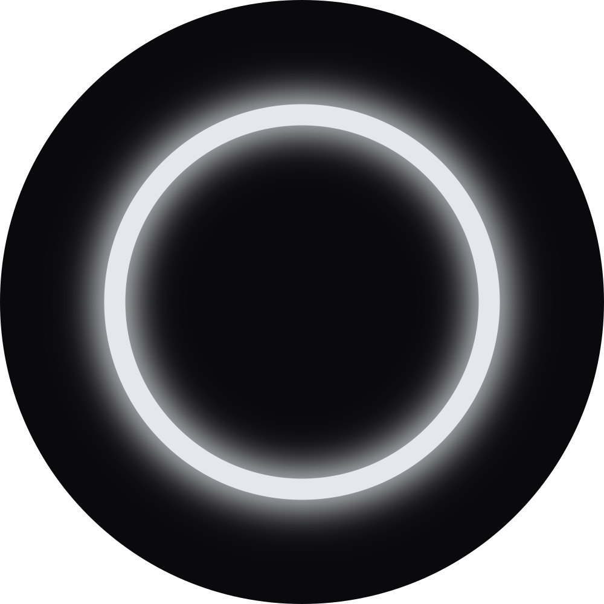
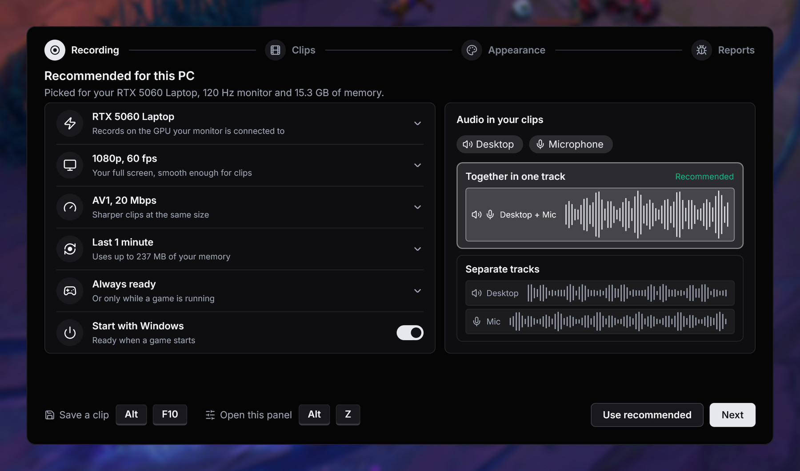
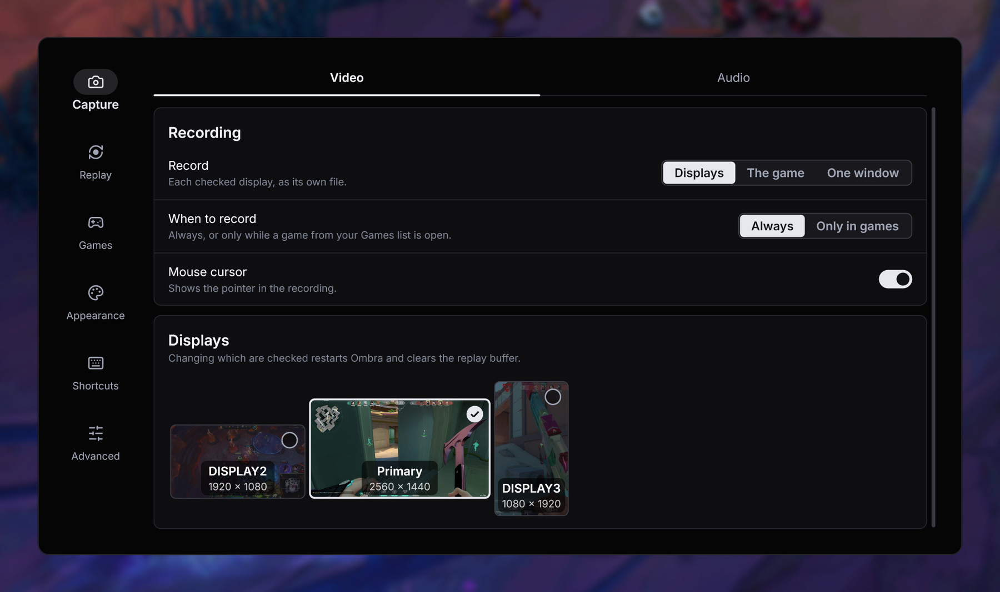
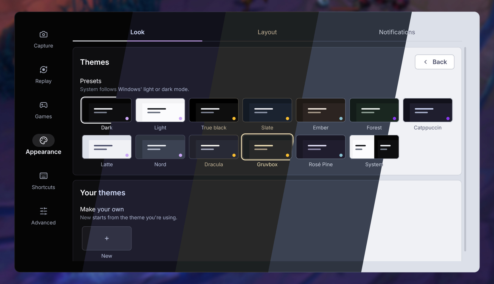
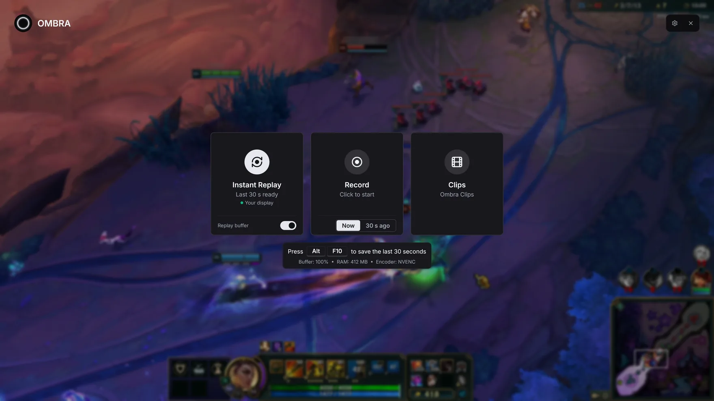
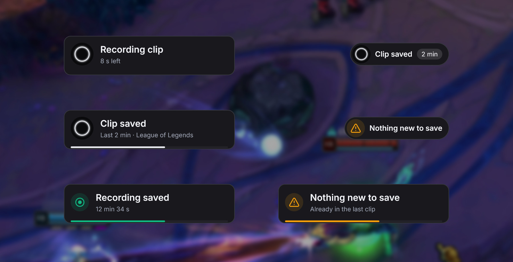

<p align="center">
  
</p>

<h1 align="center">Ombra</h1>

<p align="center">
  <b>Lightweight instant replay for Windows.</b>
</p>

<p align="center">
  <a href="../../releases/latest/download/Ombra-Setup.exe"></a>
</p>
<p align="center">
  <a href="../../releases/latest">Release notes</a> &nbsp;·&nbsp; <a href="#install">Other downloads</a>
</p>

https://github.com/user-attachments/assets/8e14c6ab-7047-4224-b035-7f010acbc301

Ombra keeps the last minutes of your screen and sound in a rolling buffer, encoded on your NVIDIA or
AMD GPU or on the CPU. One key turns the buffer into a clip, another records until you stop, and
the overlay lets you watch, trim and copy clips without leaving the game.

## Why Ombra

- **Small.** A native C++ app in a 4.4 MB installer, with no browser engine, .NET or OBS runtime
  inside. While it buffers a game it uses about 0.4% of the CPU (median over 16 hours of play:
  NVENC, AV1, 1080p at 30 fps).
- **Shows its cost.** Settings show what the buffer uses now, what it will use once full, and what
  a change would do, before you save it. Memory is taken only as footage arrives, and can be let
  go while no game runs.
- **Frame-exact trims, in the overlay.** Watch a clip, step through it frame by frame, drag its
  ends and save. Cuts land on the exact frame; the GPU re-encodes the kept part in a second or two.
- **Audio you can edit later.** Desktop, mic and chosen apps each on their own track, or grouped
  into one, each with its own volume, plus an optional track with everything mixed.
- **Every monitor at once.** One file per monitor from a single key, or just the game, or one
  window.
- **Made to be changed.** Twelve themes or your own, a panel that floats or attaches to any edge,
  and notifications you pick per event, with or without sound. [See it](#make-it-yours).
- **Scriptable.** `ombra clip`, `ombra record start`, markers and live events from any script or
  app. [Command line](#command-line).

## Preview

<a href="#preview"></a>

The first run picks settings for your PC. Keep them or change any row.

<a href="#preview"></a>

Pick the displays to record, laid out as they sit on your desk.

## Make it yours

Twelve themes come with Ombra, Catppuccin, Nord, Dracula, Gruvbox and Rosé Pine among them, or
follow Windows' light or dark mode, or make your own from any colours. Pick an accent colour, a
font, rounder or sharper corners and how dense the controls are. The panel floats in the middle of
the screen or attaches to any edge, with an optional frame around the screen. Home lays its tiles
out in a row or a column.

<a href="#make-it-yours"></a>

<a href="#make-it-yours"></a>

Notifications sit in any corner, as a card or a compact line, with or without details and a time
bar. Each event, from a saved clip to a problem, has its own popup and sound switch.

<a href="#make-it-yours"></a>

## Features

**Replay**
- A buffer of seconds up to 30 minutes, in memory or on disk for long buffers
- Always on, or only while a game runs; pause and resume with a key
- Clips sorted into a folder per game, with chapters where the game started and ended

**Recording**
- Record until you stop, starting now or up to 30 seconds back, alongside the replay buffer
- Home shows the time recorded and the space left
- A recording cut short by a crash or power cut is turned into a normal MP4 at the next start

**Capture and encoding**
- Every monitor (a file each), just the game, or one window; native, 1440p, 1080p or 720p; 30 to
  144 fps or the display's refresh rate
- NVENC (NVIDIA), AMF (AMD) or x264 (CPU); AV1 when the GPU supports it, else H.264
- Quality presets from Low to Ultra, or your own bitrate and rate control
- Gaming laptops: encodes on the NVIDIA GPU while the game runs there, otherwise on the GPU
  driving the display when it can encode. Your GPU settings and MUX switch are never changed
- Captures through Windows Graphics Capture, never by hooking the game, so games with anti-cheat
  record like any other window

**Audio**
- Desktop, mic and chosen apps, each on its own track or grouped into one
- A recording volume per source, from -24 to +12 dB, that never touches your system volume
- An optional extra track with every source mixed, for a quick upload

**Clips**
- Browse, play, trim, copy and delete from the Alt+Z overlay
- Filter by game; sort by newest, oldest, longest or largest
- Step frame by frame, jump between markers, save the trimmed part or replace the original
- Screenshots with a key

**Looks**
- Twelve themes or your own, accent colour, font, corners, density
- Panel position, floating or attached, an optional screen frame, Home in a row or a column
- Notifications: corner, style, details, time bar, length, and a popup and sound switch per event

**Automation**
- The `ombra` command line: clips, recordings, markers, status, live events, `--json` output

## Command line

The installer puts `ombra` on your PATH. Scripts, stream decks and other apps can drive Ombra
while it runs:

```powershell
ombra clip --before 30           # save the last 30 seconds, print the file
ombra marker "Ace" --kind kill   # a chapter in every clip that covers this moment
ombra record start --before 10   # record from 10 seconds ago until "ombra record stop"
ombra watch game_start game_end  # print events as they happen
```

Commands take `--json` for one line of JSON. `ombra help` lists them all, with their exit
codes.

## Install

The [installer](../../releases/latest/download/Ombra-Setup.exe) is the recommended way: it lets you
choose the folder and shortcuts, and keeps Ombra up to date.

Or from PowerShell, without the wizard (installs to `%LOCALAPPDATA%\Programs\Ombra`):

```powershell
irm https://github.com/Zyrecx/ombra/releases/latest/download/install.ps1 | iex
```

<details>
<summary><b>Other ways to install</b></summary>

<table>
<tr><td><b>Portable</b></td><td><a href="../../releases/latest"><code>Ombra-Portable.zip</code></a>: unzip anywhere and run <code>ombra.exe</code></td></tr>
<tr><td><b>winget</b></td><td><code>winget install Zyrecx.Ombra</code> (in review)</td></tr>
<tr><td><b>Scoop</b></td><td><code>scoop bucket add zyrecx https://github.com/Zyrecx/scoop-bucket</code><br><code>scoop install zyrecx/ombra</code></td></tr>
</table>

</details>

> [!NOTE]
> Builds aren't code-signed, so SmartScreen shows "Unknown publisher" when you open the
> downloaded installer.

**Requirements:** Windows 11. Hardware encoding on an NVIDIA GTX 10 series or newer (driver
471.41 or newer), or an AMD GPU with AMF; AV1 on RTX 40, RX 7000, Ryzen 7040 and newer (NVIDIA:
driver 570 or newer). Any other PC records on the CPU.

## Default keys

All of them can be changed, in Settings or during setup.

| Key | |
| --- | --- |
| <kbd>Alt</kbd> + <kbd>F10</kbd> | Save the replay |
| <kbd>Alt</kbd> + <kbd>Z</kbd> | Open the overlay |
| <kbd>Alt</kbd> + <kbd>F1</kbd> | Screenshot |
| <kbd>Alt</kbd> + <kbd>F9</kbd> | Pause or resume the buffer |

Recording has no key until you set one; the overlay's Record tile starts it. Clips are saved to
`Videos\Ombra`, in a folder per game.

## Privacy

Clips never leave your PC, and there's no account. During setup you choose what Ombra may report:
nothing, error reports (crashes and failures, with paths and names removed), or error reports plus
daily performance numbers and the games you recorded. Nothing is sent before setup finishes, and a
crash before then only if you say so. Logs go to the developer only when you press Send. Twice a day
Ombra asks GitHub whether a new version is out; nothing about you or your PC goes with it, and
Settings > Advanced turns it off. [What exactly is sent](PRIVACY.md).

## How it works

Ombra is two programs:

- **`ombra.exe`, the recorder.** Always running, in the tray. Captures the screen and audio,
  encodes them on your GPU (or CPU) into a rolling buffer, and saves a clip when you press the key.
- **`ombra-ui.exe`, the overlay.** Draws the overlay, setup and notices like "Clip saved". It
  starts only when needed and exits when closed, so nothing of it stays over your game.

## Roadmap

**Planned**

- [ ] **Ombra as a library:** other apps can offer replay and recording without their users
      installing Ombra, and use the installed Ombra when there is one
- [ ] **Add-ons:** developers can change how Ombra looks and add features of their own

**Not done yet** (ideas, open to suggestions and pull requests)

Intel encoding · Linux · several clip lengths and a bookmark key · per-game quality profiles ·
the desktop at a lower frame rate than games · export as H.264 for players without AV1 · smaller
exports for Discord · crop · GIF · automatic clips on game events

## Contributing

Bug reports, ideas and pull requests are welcome.

- **Found a bug?** [Open a bug report](../../issues/new?template=bug_report.yml) and attach the
  logs: right-click the tray icon, **Get logs**.
- **Have an idea?** [Suggest a feature](../../issues/new?template=feature_request.yml).
- **Want to code?** Read [CONTRIBUTING.md](CONTRIBUTING.md) first.

<details>
<summary><b>Build from source</b></summary>

Needs Visual Studio Build Tools (MSVC and the Windows SDK), CMake and Ninja.

```powershell
powershell -ExecutionPolicy Bypass -File build.ps1   # -> build\Release
```
</details>

## Credits

<table>
<tr><td><a href="https://www.videolan.org/developers/x264.html">x264</a></td><td>CPU encoder</td></tr>
<tr><td><a href="https://obsproject.com">OBS Studio</a></td><td>The MP4 writer is adapted from its muxer</td></tr>
<tr><td><a href="https://ffmpeg.org">FFmpeg</a></td><td>AV1 header parsing</td></tr>
<tr><td>NVIDIA Video Codec SDK, AMD AMF</td><td>Hardware encoder headers</td></tr>
<tr><td><a href="https://github.com/noctalia-dev/noctalia-shell">Noctalia</a></td><td>The overlay's panel and layout model</td></tr>
<tr><td><a href="https://lucide.dev">Lucide</a></td><td>Icons</td></tr>
<tr><td><a href="https://rsms.me/inter/">Inter</a>, <a href="https://vercel.com/font">Geist</a></td><td>Fonts</td></tr>
</table>

Ombra is free software under the [GPL-3.0](LICENSE). Licences and notices:
[THIRD-PARTY-NOTICES.txt](THIRD-PARTY-NOTICES.txt).
