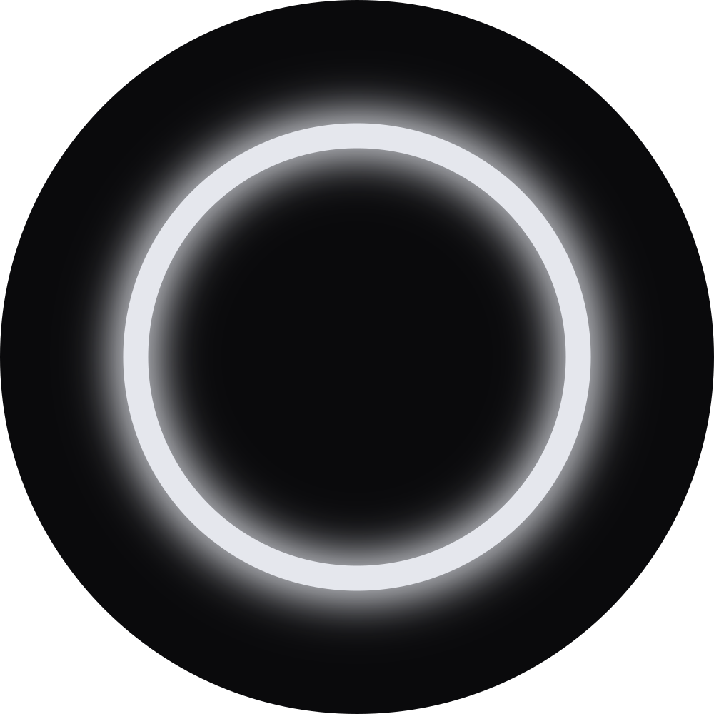
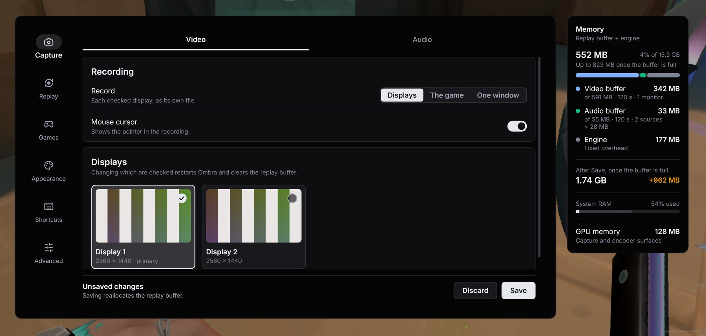
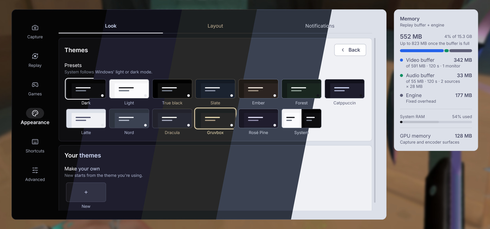
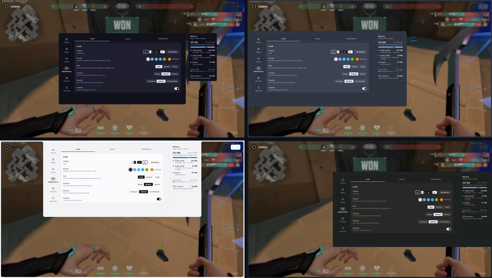

<p align="center">
  
</p>

<h1 align="center">Ombra</h1>

<p align="center">
  <b>Lightweight instant replay for Windows.</b>
</p>

<p align="center">
  <a href="../../releases/latest/download/Ombra-Setup.exe"></a>
</p>
<p align="center">
  <a href="../../releases/latest">Release notes</a> &nbsp;·&nbsp; <a href="#install">Other downloads</a>
</p>

https://github.com/user-attachments/assets/DEMO-VIDEO-PLACEHOLDER

Ombra keeps the last minutes of your screen and sound in a rolling buffer, encoded on your NVIDIA or
AMD GPU or on the CPU. When something happens worth keeping, one key turns the buffer into a clip,
and the overlay lets you watch and trim it without leaving the game.

## Why Ombra

- **Safe with anti-cheat.** Ombra captures through Windows Graphics Capture. It never hooks or
  injects into the game, so games behind anti-cheat such as Vanguard record like any other window.
- **Small.** A native C++ app of about 5 MB, with no browser engine, .NET or OBS runtime inside.
  The buffer takes memory only as footage arrives, and can let go of it while no game runs.
- **Shows its cost.** Settings show what the buffer uses now, what it will use once full, and what
  a change would do, before you save it.
- **Frame-exact trims, in the overlay.** Watch a clip, drag its ends and save. Cuts land on the
  exact frame; the GPU re-encodes the kept part in a second or two.
- **Yours to style.** Twelve themes or one of your own, any accent colour, and a panel that floats
  in the middle or attaches to any edge of the screen. [See it](#make-it-yours).

## Preview

<a href="#preview"></a>

The memory card: what the buffer costs, before you save.

## Make it yours

Twelve themes come with Ombra, Catppuccin, Nord, Dracula, Gruvbox and Rosé Pine among them, or
make your own from any colours. Pick an accent colour, a font, rounder or sharper corners and how
dense the controls are. The panel floats in the middle of the screen or attaches to any edge, with
an optional frame around the screen.

<a href="#make-it-yours"></a>

<a href="#make-it-yours"></a>

## Features

<table>
<tr><td>🎬 <b>Replay</b></td><td>Seconds up to 30 minutes, kept in memory, or on disk for long buffers</td></tr>
<tr><td>⚡ <b>Encoding</b></td><td>NVENC (NVIDIA), AMF (AMD) or x264 (CPU). AV1 when the GPU supports it, else H.264</td></tr>
<tr><td>🖥️ <b>Capture</b></td><td>Every monitor (a file each), just the game, or one window. Always, or only while a game runs</td></tr>
<tr><td>🎧 <b>Audio</b></td><td>Desktop and mic in one track or separate ones, or chosen apps on their own tracks</td></tr>
<tr><td>✂️ <b>Clips</b></td><td>Browse, play, trim, copy and delete from the Alt+Z overlay; a folder per game</td></tr>
<tr><td>🎨 <b>Looks</b></td><td>Twelve themes or your own, accent colour, font, corners, density, panel position, screen frame</td></tr>
</table>

## Install

The [installer](../../releases/latest/download/Ombra-Setup.exe) is the recommended way: it lets you
choose the folder and shortcuts, and keeps Ombra up to date.

<details>
<summary><b>Other ways to install</b></summary>

<table>
<tr><td><b>Portable</b></td><td><a href="../../releases/latest"><code>Ombra-Portable.zip</code></a>: unzip anywhere and run <code>ombra.exe</code></td></tr>
<tr><td><b>winget</b></td><td>Pending</td></tr>
<tr><td><b>Scoop</b></td><td>Pending</td></tr>
<tr><td><b>PowerShell</b></td><td>Pending</td></tr>
</table>

</details>

> [!NOTE]
> Builds aren't code-signed, so SmartScreen shows "Unknown publisher" the first time.

**Requirements:** Windows 11. Hardware encoding on an NVIDIA GTX 10 series or newer with an
up-to-date driver, or an AMD GPU with AMF; AV1 on RTX 40, RX 7000, Ryzen 7040 and newer. Any other
PC records on the CPU.

## Default keys

All of them can be changed, in Settings or during setup.

| Key | |
| --- | --- |
| <kbd>Alt</kbd> + <kbd>F10</kbd> | Save the replay |
| <kbd>Alt</kbd> + <kbd>Z</kbd> | Open the overlay |
| <kbd>Alt</kbd> + <kbd>F1</kbd> | Screenshot |
| <kbd>Alt</kbd> + <kbd>F9</kbd> | Pause or resume the buffer |

Clips are saved to `Videos\Ombra`, in a folder per game.

## Privacy

Clips never leave your PC, and there's no account. During setup you choose what Ombra may report:
nothing, error reports (crashes and failures, with paths and names removed), or error reports plus
daily performance numbers and the games you recorded. Nothing is sent before setup finishes, and a
crash before then only if you say so. Logs go to the developer only when you press Send. Twice a day
Ombra asks GitHub whether a new version is out; nothing about you or your PC goes with it, and
Settings > Advanced turns it off. [What exactly is sent](PRIVACY.md).

## How it works

Ombra is two programs:

- **`ombra.exe`, the recorder.** Always running, in the tray. Captures the screen and audio,
  encodes them on your GPU (or CPU) into a rolling buffer, and saves a clip when you press the key.
- **`ombra-ui.exe`, the overlay.** Draws the overlay, setup and notices like "Clip saved". It
  starts only when needed and exits when closed, so nothing of it stays over your game.

## Roadmap

**Planned**

- [ ] **Command line:** `ombra save`, start and stop a recording, and events when games start and
      end, so scripts and other tools can drive Ombra
- [ ] **Recording:** record a whole session, alongside the replay buffer
- [ ] **Ombra as a library:** other apps can offer replay and recording without their users
      installing Ombra, and use the installed Ombra when there is one
- [ ] **Add-ons:** developers can change how Ombra looks and add features of their own

**Not done yet** (ideas, open to suggestions and pull requests)

Intel encoding · Linux · several clip lengths and a bookmark key · per-game quality profiles ·
the desktop at a lower frame rate than games · export as H.264 for players without AV1 · smaller
exports for Discord · crop · GIF · automatic clips on game events

## Contributing

Bug reports, ideas and pull requests are welcome.

- **Found a bug?** [Open a bug report](../../issues/new?template=bug_report.yml) and attach the
  logs: right-click the tray icon, **Get logs**.
- **Have an idea?** [Suggest a feature](../../issues/new?template=feature_request.yml).
- **Want to code?** Read [CONTRIBUTING.md](CONTRIBUTING.md) first.

<details>
<summary><b>Build from source</b></summary>

Needs Visual Studio Build Tools (MSVC and the Windows SDK), CMake and Ninja.

```powershell
powershell -ExecutionPolicy Bypass -File build.ps1   # -> build\Release
```
</details>

## Credits

<table>
<tr><td><a href="https://www.videolan.org/developers/x264.html">x264</a></td><td>CPU encoder</td></tr>
<tr><td><a href="https://obsproject.com">OBS Studio</a></td><td>The MP4 writer is adapted from its muxer</td></tr>
<tr><td><a href="https://ffmpeg.org">FFmpeg</a></td><td>AV1 header parsing</td></tr>
<tr><td>NVIDIA Video Codec SDK, AMD AMF</td><td>Hardware encoder headers</td></tr>
<tr><td><a href="https://github.com/noctalia-dev/noctalia-shell">Noctalia</a></td><td>The overlay's panel and layout model</td></tr>
<tr><td><a href="https://lucide.dev">Lucide</a></td><td>Icons</td></tr>
<tr><td><a href="https://rsms.me/inter/">Inter</a>, <a href="https://vercel.com/font">Geist</a></td><td>Fonts</td></tr>
</table>

Ombra is free software under the [GPL-3.0](LICENSE). Licences and notices:
[THIRD-PARTY-NOTICES.txt](THIRD-PARTY-NOTICES.txt).
